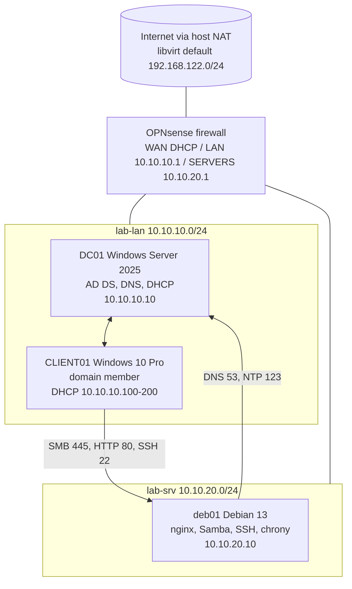

# Virtual Home Lab: Windows and Linux Enterprise Environment

A complete mini-enterprise network built on **QEMU/KVM** (virt-manager): a routed, firewalled environment with Active Directory, DNS, DHCP, Group Policy, a Linux file and web server, and a documented security policy.

This project is a hands-on demonstration of core System Administrator work: virtualization, networking, Windows Server and Linux administration, identity and access management, time services, firewalling and troubleshooting.

## Skills demonstrated

| Area                       | What I did                                                                                        |
| -------------------------- | ------------------------------------------------------------------------------------------------- |
| Virtualization             | KVM/libvirt with isolated virtual networks, VM sizing for a 16 GB host, snapshots as a safety net |
| Networking and firewalling | OPNsense routing three subnets, NAT, stateful rules written as least privilege                    |
| Windows Server             | Active Directory forest, integrated DNS, DHCP, OUs, groups, users, a separate admin account       |
| Group Policy               | User and computer policies, password and lockout policy, drive mapping with item-level targeting  |
| Linux administration       | Static networking, SSH with key-only login, nginx, Samba, chrony, nftables                        |
| Identity and access        | Role-based groups in AD mapped to file-share permissions, allowed and denied access tests         |
| Time services              | One time authority for the domain, with the Linux server following it                             |

## Architecture

![[diagram.png]]

- Domain: `barab0lia.internal` (NetBIOS `BARAB0LIA`). The `.internal` suffix is reserved for private use, which avoids the mDNS conflict of `.local`.
- Full addressing is in [ip-plan.md](ip-plan.md).

## What I would do differently in production

See [docs/production-notes.md](docs/production-notes.md): join Samba to AD, add a second DC eliminating single point of failure,  central logging, backups backups and backups again, and more.
