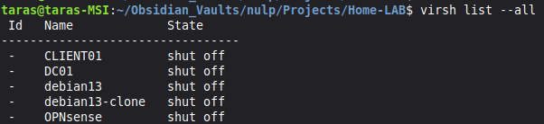
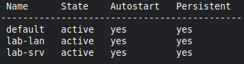

**Goal:** create the network foundation first, because every VM depends on it.
**What I did:** defined two isolated libvirt networks, `lab-lan` (10.10.10.0/24) and `lab-srv` (10.10.20.0/24), with no libvirt DHCP or NAT, so the lab firewall is the only gateway.
**Why isolated:** nothing outside the lab can reach it, and nothing inside gets an address from the wrong source.

----


First we need to install all the OS in QEMU/KVM

After successfully accomplished previous tedious and time consuming task, it's the best time to take a snapshot of each installed so in case of failure we can unpainfully revert to the working state.

The next task in the current phase is to define networks in KVM. In KVM networks are defined using .xml files.
The first isolated network:
```xml
<!-- lab-lan.xml --> 
<network> 
	<name>lab-lan</name> 
	<bridge name='br-lablan' stp='on' delay='0'/> 
</network>
```
The second:
```xml
<!-- lab-srv.xml --> 
<network> 
	<name>lab-srv</name> 
	<bridge name='br-labsrv' stp='on' delay='0'/> 
</network>
```

There are no forward and ip elements which makes the network isolated. There is no default libvirt DHCP service.
There is no need in DHCP service in both of the LANs because in lab-lan Windows Server will take the responsibility of DHCP. In lab-srv static IP address will be assigned

After creating these .xml files we need to define and activate them in KVM
```bash
virsh net-define lab-lan.xml && virsh net-start lab-lan && virsh net-autostart lab-lan 
virsh net-define lab-srv.xml && virsh net-start lab-srv && virsh net-autostart lab-srv 
virsh net-list --all
```

