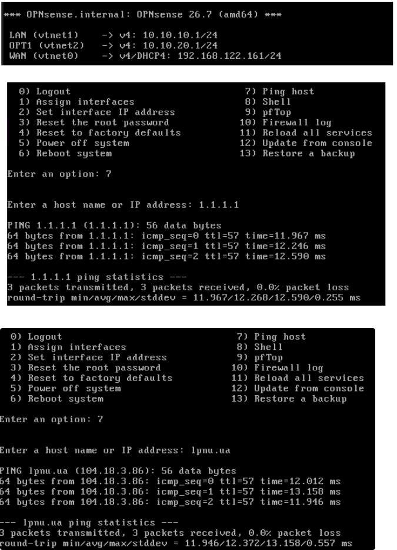
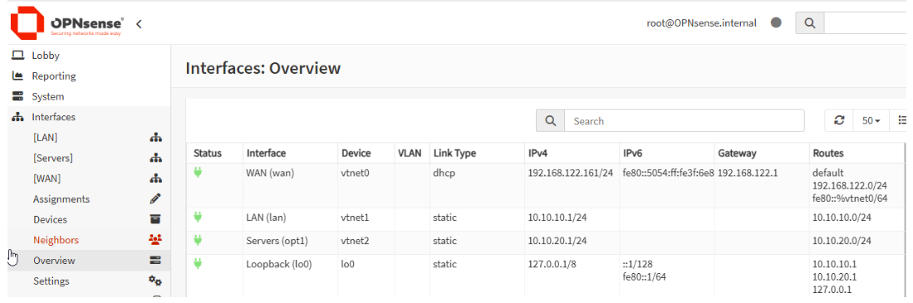

**Goal:** a router and firewall between the internet, the client LAN and the server subnet.
**What I did:** three virtio NICs in a fixed order (`default` as WAN, `lab-lan` as LAN, `lab-srv` as SERVERS). Assigned interfaces by MAC address, set LAN to 10.10.10.1/24 and SERVERS to 10.10.20.1/24, and left DHCP off so the domain controller is the only DHCP server. Verified WAN connectivity with ping tests.

---

Networks that were assigned to OPNsense VM before boot
```xml
<interface type="network">
      <mac address="52:54:00:18:8c:68"/>
      <source network="default"/>
      <model type="virtio"/>
      <address type="pci" domain="0x0000" bus="0x00" slot="0x03" function="0x0"/>
    </interface>
    <interface type="network">
      <mac address="52:54:00:92:23:38"/>
      <source network="lab-lan"/>
      <model type="virtio"/>
      <address type="pci" domain="0x0000" bus="0x00" slot="0x04" function="0x0"/>
    </interface>
    <interface type="network">
      <mac address="52:54:00:2b:21:95"/>
      <source network="lab-srv"/>
      <model type="virtio"/>
      <address type="pci" domain="0x0000" bus="0x00" slot="0x05" function="0x0"/>
    </interface>
```

The OPNsense has the following interfaces

| Host     | Interface     | Network | IP                     | Logical Name | Role            |
| -------- | ------------- | ------- | ---------------------- | ------------ | --------------- |
| OPNsense | WAN (vtnet0)  | default | DHCP (192.168.122.161) | vtnet0       | Uplink          |
| OPNsense | LAN (vtnet1)  | lab-lan | 10.10.10.1/24          | vtnet1       | LAN gateway     |
| OPNsense | OPT1 (vtnet2) | lab-srv | 10.10.20.1/24          | vtnet2       | Servers gateway |
To configure interfaces you need to enter 2 in menu and the follow-up questions will be prompted to configure devices.
After having gone through this process, we have the following configuration.
==🟢NOTE==: During the configuration DHCP was disabled on LAN and OPT1 interfaces because it is not needed due to Windows Server DHCP functionality in LAN and static IP configuration in OPT1. On WAN interface DHCP is enabled because it is necessary to get the IP address from libvirt hypervisor. IPv6 configuration was left blank in this lab.



The OPNsense console banner (`OPNsense.internal`) confirms all assigned subnets are active:

- **WAN (`vtnet0`)**: Obtains its IPv4 address via DHCP (`192.168.122.161/24`) from the upstream virtualization network, serving as the default route to the internet.
- **LAN (`vtnet1`)**: Configured with a static IP of `10.10.10.1/24`, acting as the default gateway and primary management interface for internal devices.
- **OPT1 (`vtnet2`)**: Configured with a static IP of `10.10.20.1/24`, isolating server assets into their own Layer 3 broadcast domain (`lab-srv`).

Okay. After making the configuration we need to test the functionality of it. We will use ping host option from OPNsense menu to check reachability to external network from WAN OPNsense NIC.

1. **Layer 3 Internet Reachability (`1.1.1.1`)**
    - Target: Cloudflare Public DNS (`1.1.1.1`)
    - Result: 3 packets transmitted, 3 received, 0.0% packet loss (Average round-trip time: `12.27 ms`).
    - Status: Confirms the default gateway route through `vtnet0` (WAN) is operational and NAT/outbound routing is functioning.
2. **DNS Resolution & FQDN Reachability (`lpnu.ua`)**
    - Target: `lpnu.ua` (resolved to `104.18.3.86`)
    - Result 3 packets transmitted, 3 received, 0.0% packet loss (Average round-trip time: `12.37 ms`).
    - Status: Confirms both recursive DNS resolution and end-to-end domain routing are active.


