**Goal:** the identity and name-resolution backbone of the lab.
**What I did:**
1. Static IP 10.10.10.10, renamed to `DC01` before promotion
2. Installed AD DS and promoted DC01 to a new forest, `barab0lia.internal`.
3. Added a DNS forwarder to OPNsense, so internal names resolve locally and everything else goes out through the firewall.
4. Installed DHCP, authorized it in AD, and created scope `LAN_Clients` (10.10.10.100-200) with router, DNS server and domain options.
5. Built the OU structure (`Lab` with `Users` split into IT, HR, Sales and Accountant, plus `Groups`, `Workstations`, `Servers`), four security groups (`GG_IT`, `GG_HR`, `GG_Sales`, `GG_Accountant`) and users from scripts. Admin work uses a separate account (`adm.taras`) instead of the built-in Administrator.

----


First things first we need to assign network parameters to the network host. It's possible to accomplish it using GUI or CLI
A cmdlet `New-NetIPAddress` is used to assign network parameters to interface
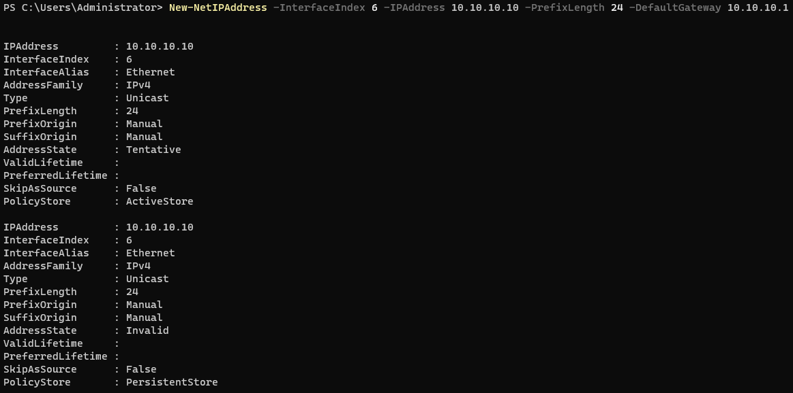


Change the hostname of this network host and verify the network configuration
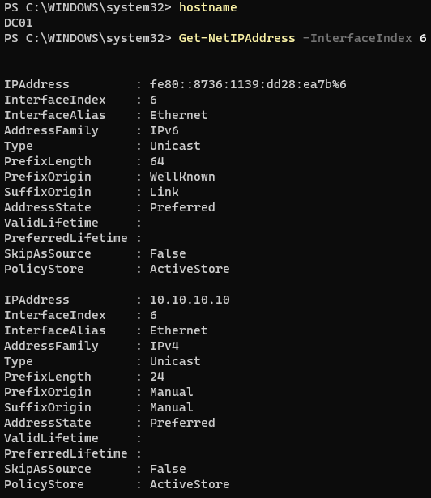


Next we will install the Active Directory Domain Service 
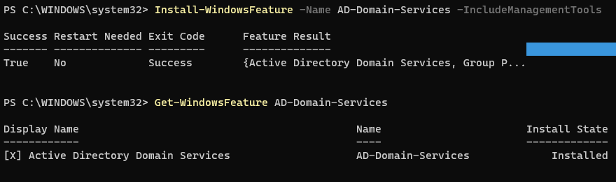

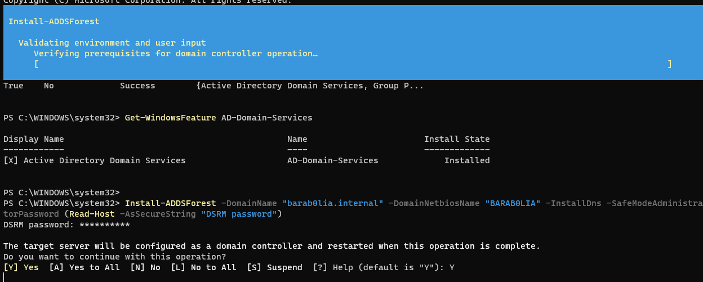

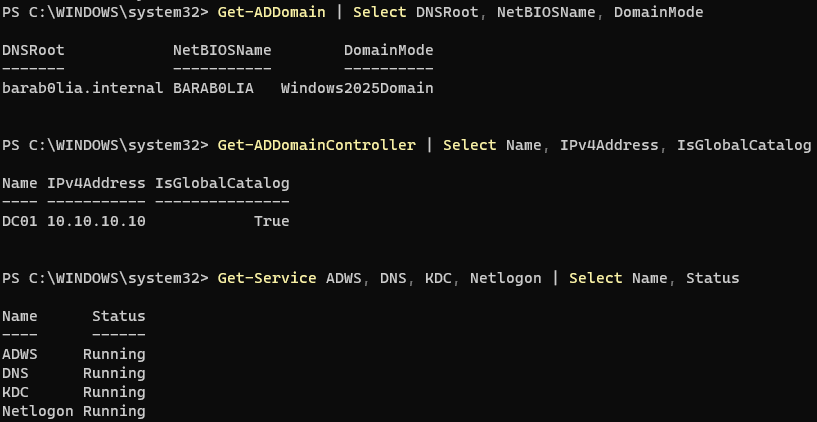

Installing DHCP Service on DC01
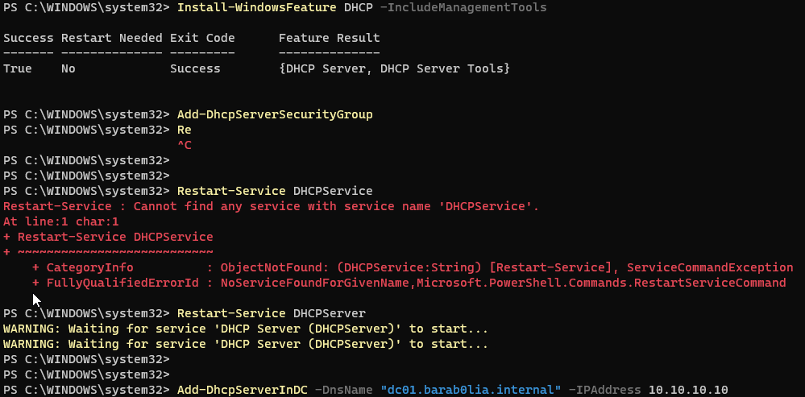
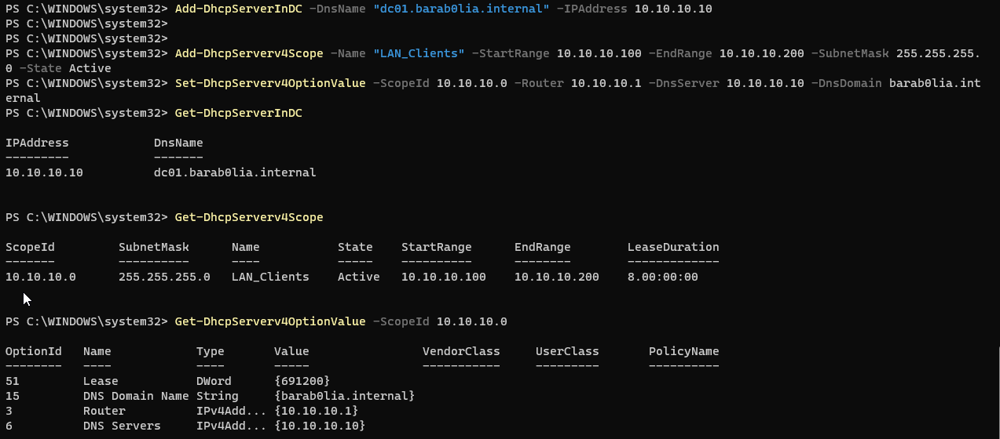

`Add-DhcpServerInDC` - Authorizes the server in AD. An unauthorized DHCP server in a domain refuses to hand out leases. This is a safeguard against rogue DHCP servers


Creating OUs
```powershell
$base = (Get-ADDomain).DistinguishedName
New-ADOrganizationalUnit -Name "Lab" -Path $base
$lab = "OU=Lab,$base"
"Users","Groups","Workstations","Servers" | ForEach-Object { New-ADOrganizationalUnit -Name $_ -Path $lab }
"IT","HR","Sales","Accountant" | ForEach-Object { New-ADOrganizationalUnit -Name $_ -Path "OU=Users,$lab" }
"GG_IT","GG_HR","GG_Sales","GG_Accountant" | ForEach-Object {
  New-ADGroup -Name $_ -GroupScope Global -GroupCategory Security -Path "OU=Groups,$lab" }
```


Creating users in OUs
```powershell
$base = (Get-ADDomain).DistinguishedName
$lab  = "OU=Lab,$base"
$upn  = (Get-ADDomain).DNSRoot
$pw   = Read-Host -AsSecureString "Password for users"

$users = @(
  @{N="Kono IT";         S="kono.it";         D="IT";         G="GG_IT"},
  @{N="Sheva HR";        S="sheva.hr";        D="HR";         G="GG_HR"},
  @{N="Carol Sales";     S="carol.sales";     D="Sales";      G="GG_Sales"},
  @{N="Bob Accountant";  S="bob.accountant";  D="Accountant"; G="GG_Accountant"}
)

foreach ($u in $users) {
  New-ADUser -Name $u.N -SamAccountName $u.S -UserPrincipalName "$($u.S)@$upn" -Path "OU=$($u.D),OU=Users,$lab" -AccountPassword $pw -Enabled $true
  Add-ADGroupMember -Identity $u.G -Members $u.S
}

New-ADUser -Name "Admin Taras" -SamAccountName "adm.taras" -UserPrincipalName "adm.taras@$upn" -Path "OU=IT,OU=Users,$lab" -AccountPassword $pw -Enabled $true
Add-ADGroupMember -Identity "Domain Admins" -Members "adm.taras"
```

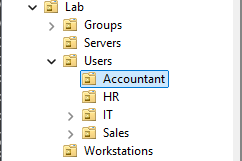

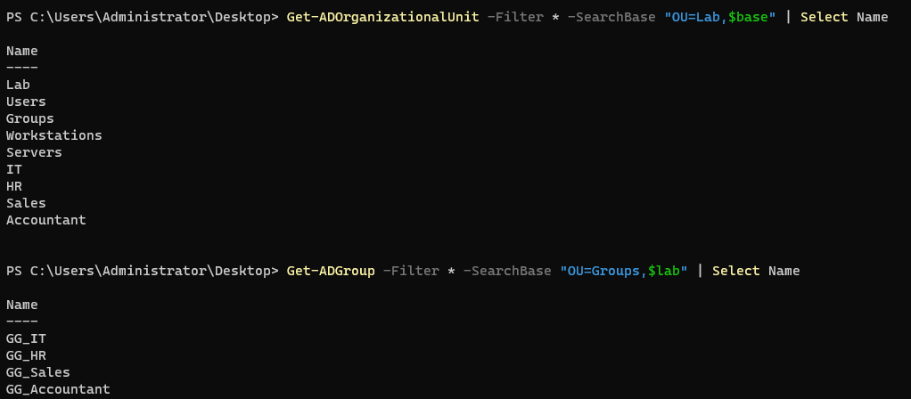

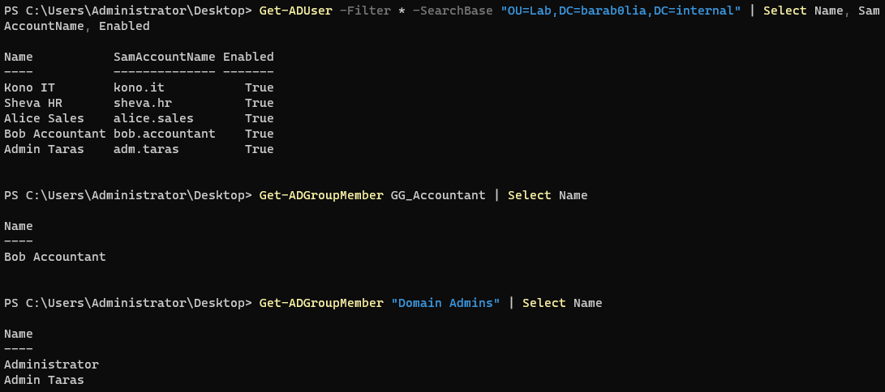

Lets go through the process of creating user using GUI. Navigate to Active Directory Users and Computers and find the OU you want to add user to
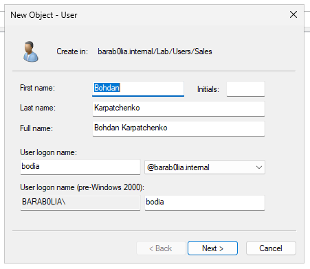
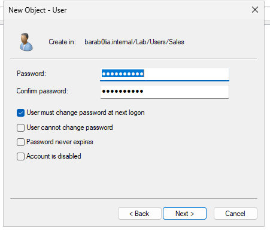
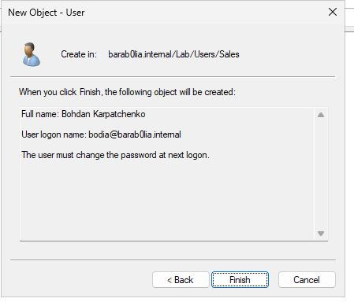
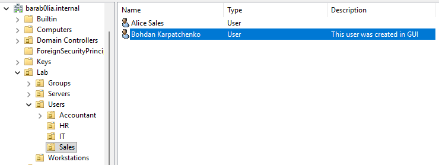


On Windows Server it is necessary to add DNS Forwarder address in order to have the ability to reach external domains. So any domain name that our Domain Controller can't resolve will be transmitted to OPNsense. In our example OPNsense 10.10.10.1 address is set as a DNS Forwarder. From Powershell execute the command

```powershell
Add-DnsServerForwarder -IPAddress 10.10.10.1
```

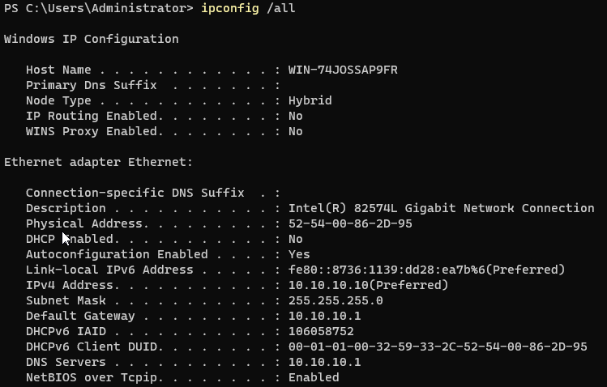


Check DNS resolution
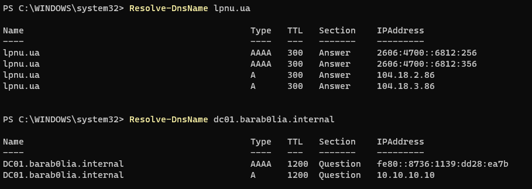