**Goal:** a multi-role Linux server that integrates with the domain.

| Service                  | What I did                                                                                                                                                                                         |
| ------------------------ | -------------------------------------------------------------------------------------------------------------------------------------------------------------------------------------------------- |
| Networking               | Static IP 10.10.20.10/24, DNS pointing at DC01, A record `deb01.barab0lia.internal`                                                                                                                |
| SSH                      | Key-based login from the domain client, then hardened with a drop-in file: no passwords, no root login, `AllowUsers`                                                                               |
| Time (chrony)            | `deb01` follows DC01, which follows external NTP pools.                                                                                                                                            |
| Web (nginx)              | Test site reachable by name from the client across the firewall                                                                                                                                    |
| File server (Samba)      | Standalone server, shares `Company` (group `smb-all`) and `IT` (group `smb-it`). Group-based permissions. Tested: the IT user opens both shares, the HR user opens `Company` and is denied on `IT` |
| Host firewall (nftables) | Default drop on input, allow only SSH, HTTP and SMB from the client LAN. Legacy SMB port 139 blocked, and the drive maps work on 445                                                               |

---

After installing the Debian system, the first step is to correctly configure the network parametrs regarding to the plan. This host should be in 10.10.20.0/24 network. We will assign static IP address. 
In order to persist reboot we added the network configuration to the following file
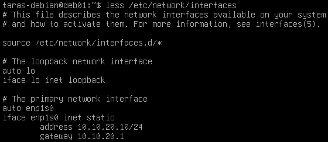
After making any changes to this file it is necessary to run `systemctl restart networking` command so the system applies the changes 

Review the configuration
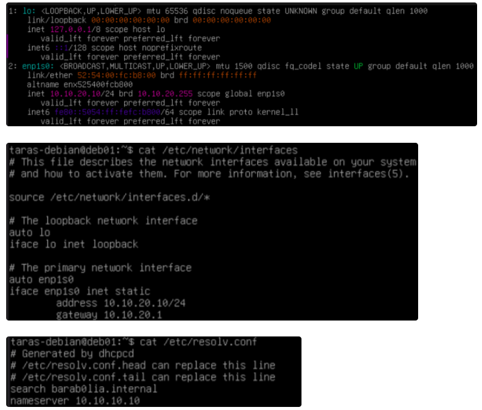

Test the configuration using ping command
We can reach default gateway as well as external network.
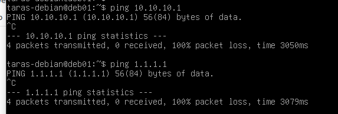

DNS name resolution works correctly. All devices in network uses Domain Controller as a DNS server. So the DNS request first go to the Windows Server host.
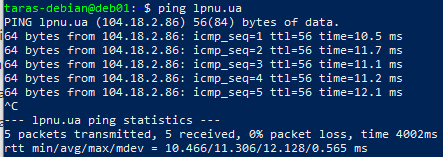

Ensure that SSH was successfully installed and configured. The service is active and the port 22 is opened for receiving incoming connections 
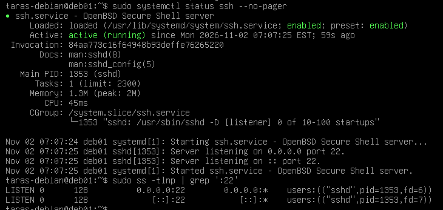


==🔵SSH Key-Authentication==
More convenient and secure option is to log into SSH using keys instead of passwords

In order to have the ability to login into debian system using SSH we need to put public keys in the specified folder on `~/.ssh/authorized_keys`. 
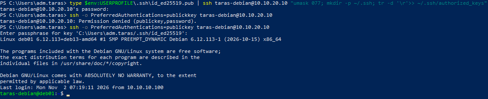

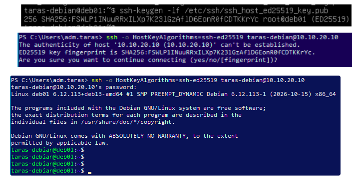

**SSH hardening**

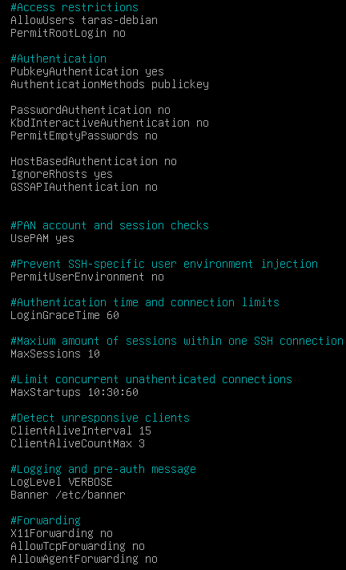

Extremely important to check the SSH config before reloading with the command
```bash
sshd -t
```

To make sure that our changes was successfully applied we tried to log in by password. And as expected SSH server refuses password-based authentication.
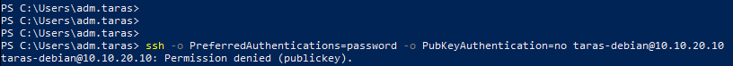


**==🟡Chrony**==
 To ensure the correct work between all systems we need to guarantee that their time is synchronized . To ensure so we will use `chrony`. It is a background daemon/program that implements the Network Time Protocol to synchronize system clocks across various systems. 
 
 But why does time synchronization across systems crucial in digital infrastructure?
 
 For Windows environments time synchronization is crucial for the operation of Kerberos protocol. Discrepancies in time can lead to authentication failures. 
 
 Kerberos client on the local computer encrypts a timestamp inside the authenticator request using it's own password and sends it to the KDC (Key Distribution Center). KDC can decrypt this message because it has the same password as on local computer (shared secret) and verifies the time within that request with a specified amount of the local time in the KDC (default - 5min).  If the timestamp is indeed in that range the system assume that the credentails presented are genuine.
All tickets by the KDC have an expiration time. Thus, if a ticket is compromised, it cannot be used outside of a specified time range — usually short enough to make the risk of a replay attack minimal. 
In fact adversaries can execute replay attack but it must only happen within the time of that window. 

Some other important reasons
- Log correlation and cybersecurity forensic analysis. 
```txt
When security incident or system failure happen, engineers must review log files across hundreds or thousands of various network hosts such as firewalls, servers, databases etc. It would be impossible to build an accurate timeline of the event. In addition SIEM systems will not automatically correlate suspicious actions that occurred on different devices
```
- Digital Certificates in HTTPS/TLS
```txt
Every TLS certificate that is used to secure communication between web and internal applications has two strict specs: "Valid from" and "Valid To". If a clinet or a server has an inconsistent clock it may interpret comletely valid certificate as "already expired/not valid". It can block the websites, APIs etc.
```
- Backup Scheduling and Data Replication
```txt
Automated backup systems usually run on strict schedules and rely on file modification timestamps to perform incremental updates (only backing up files changed since the last run). Time drift can cause the backup engine to skip critical data files, incorrectly assuming they haven't changed.
```

Installing chrony using the command 
```bash
sudo apt install chrony
```
After that we will set our DC as a source of truth for time synchronization. To do so we need to add the next line to a newly created file `dc01.sources` in `/etc/chrony/sources.d/` directory

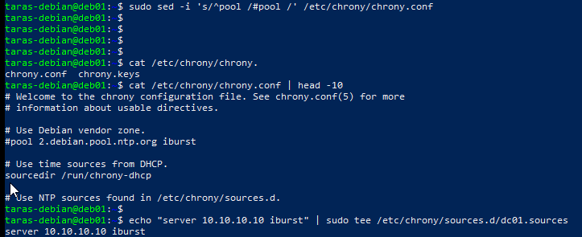

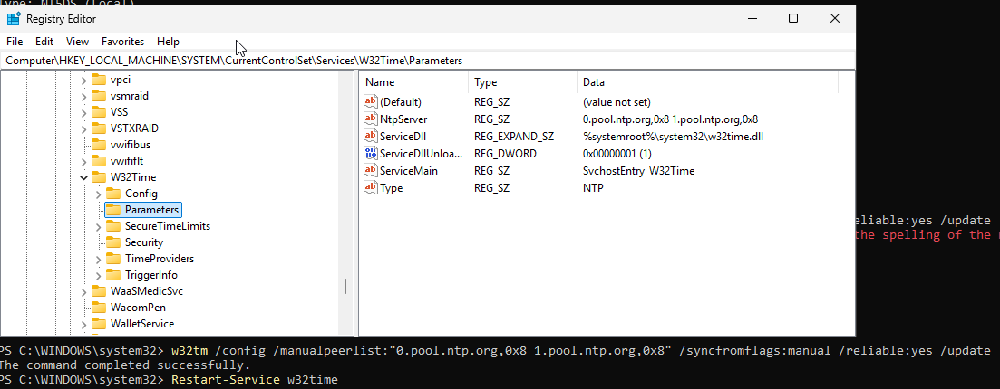


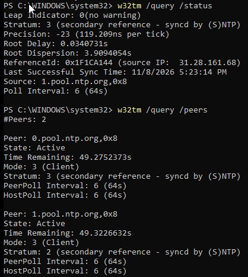

Now check if the Debian server sync it's time with Domain Controller
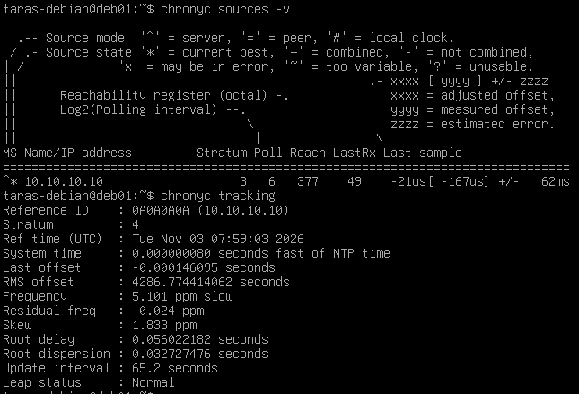


==🟡Nginx==
Install and setup a simple webpage
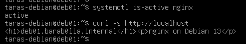

In order to reach the webpage by domain name it is necessary to add the DNS record 
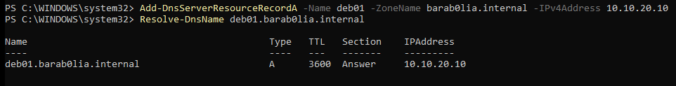

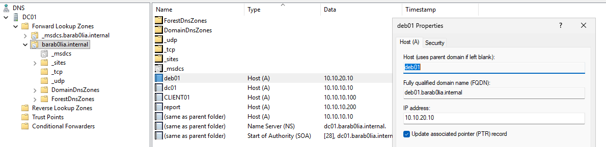


Now from the client host we should be able to resolve the newly added DNS name and open the webpage by name
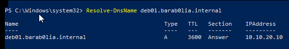

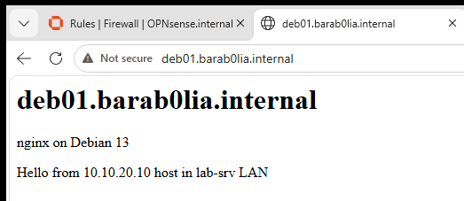


==🟡Samba==
Creating seperate groups for SMB purposes; create directories; change the group on directories and specify permissions
Let's break the `chmod 2770`
- 2 sets the SGID on directory. It states that any new created files and folders within that directory inherit the group ownership of the parent directory
- 7 - full access (read, write, execute) for the user who created the directory
- 7 - full access (read, write, execute) for any user inside the group
- 0 - zero access for others
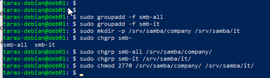

Editing SMB configuration file by adding new network shares
```txt
[Company] 
path = /srv/samba/company -> where files will be stored
read only = no -> can edit/add/delete files from this directory
valid users = @smb-all -> access is granted for all users in smb-all group
force group = smb-all -> new files/folders belongs to smb-all group
create mask = 0660 -> new files gets the permissions: rw-rw----
directory mask = 2770
```
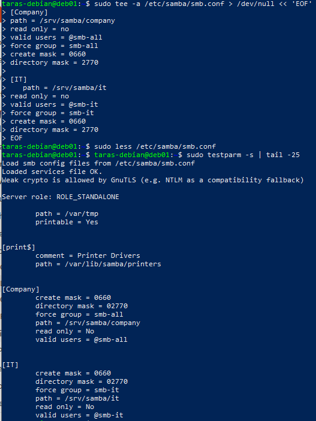

Creating users and adding them to groups
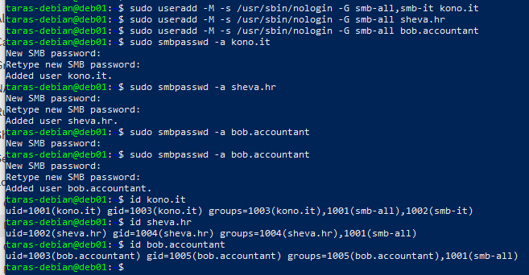

pdbedit command to manage the SAM database (Database of Samba Users)
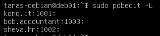


Testing: Log in as a user from IT OU. 
Expected behaviour: Access to both shares IT and Company
Result: User from IT OU has access to both shares -> Success
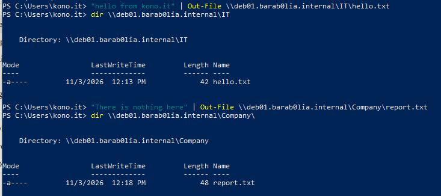


Log in as a user from HR OU to check permissions functionality
Expected behaviour: Have access to `Company`  share. Deny access to `IT` share.
Result: User has from HR OU has access to `Company`  share. Access to `IT` share is denied -> success
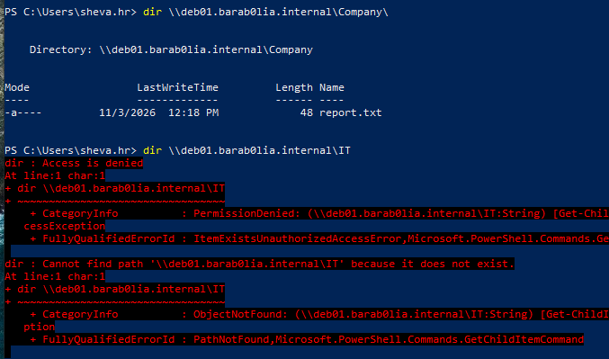


Access to the file in `Company` share by a user from HR OU.
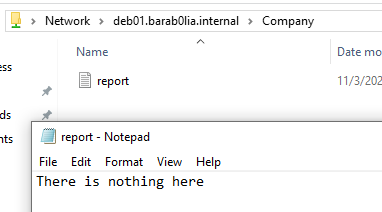


==🟣Drive Map - GPO==
Instead of typing each time this long and tedious string to reach a share `\\deb01.barab0lia.internal\Company` we can bind each share to specific drive that will appear in File Explorer with the letter we specified like `C: or D:` drives

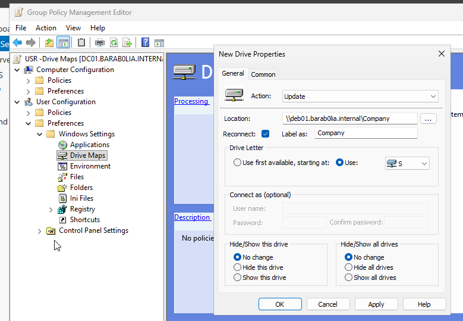


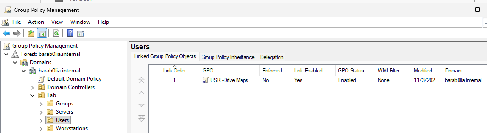


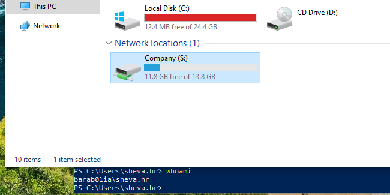


Drive Map for `IT share` will only be mapped and showed for users that are in GG_IT security group
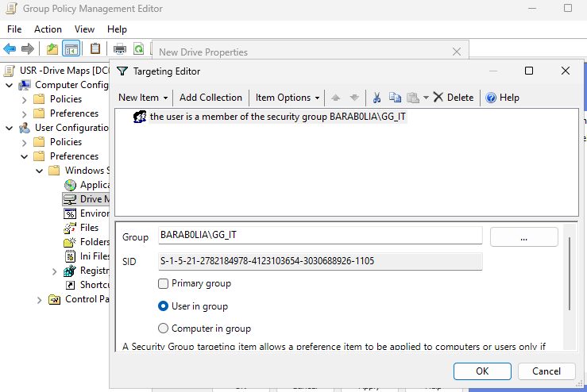


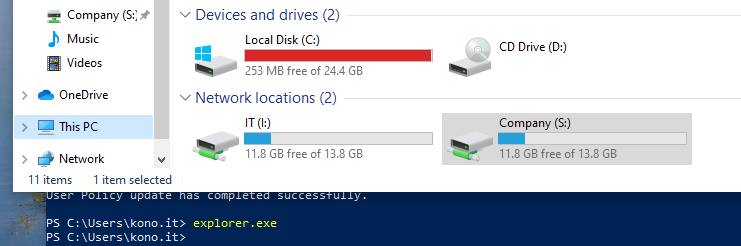

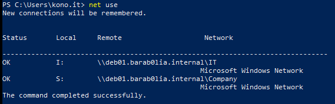


Check if Bob from Accountant OU can see the Drive Map
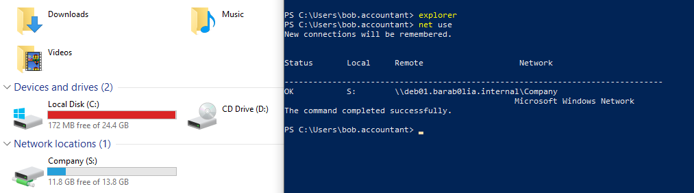


Enable SMB only on 445 port deliberately by defining it in smb.conf file
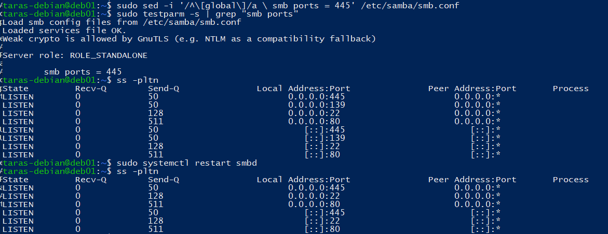

Using nftables for traffic filtering on a host
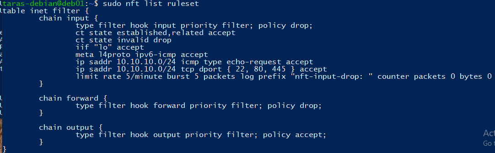

nft rules in action blocking requests to ports to all ports that are no listed in ruleset
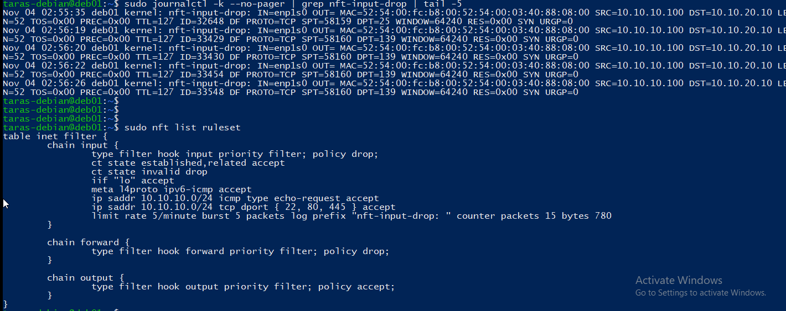
